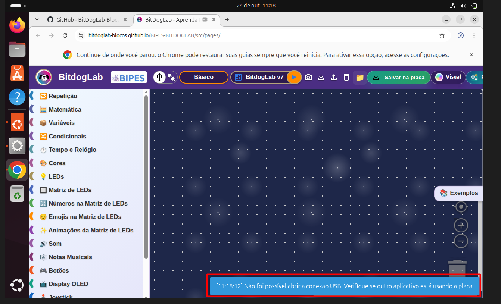
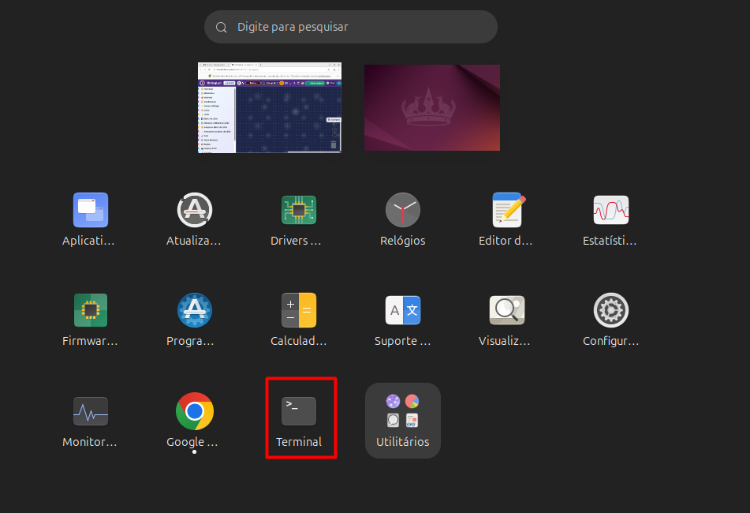
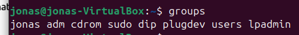
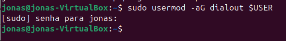
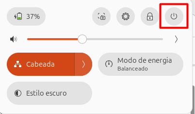
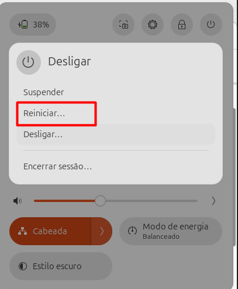
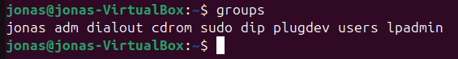
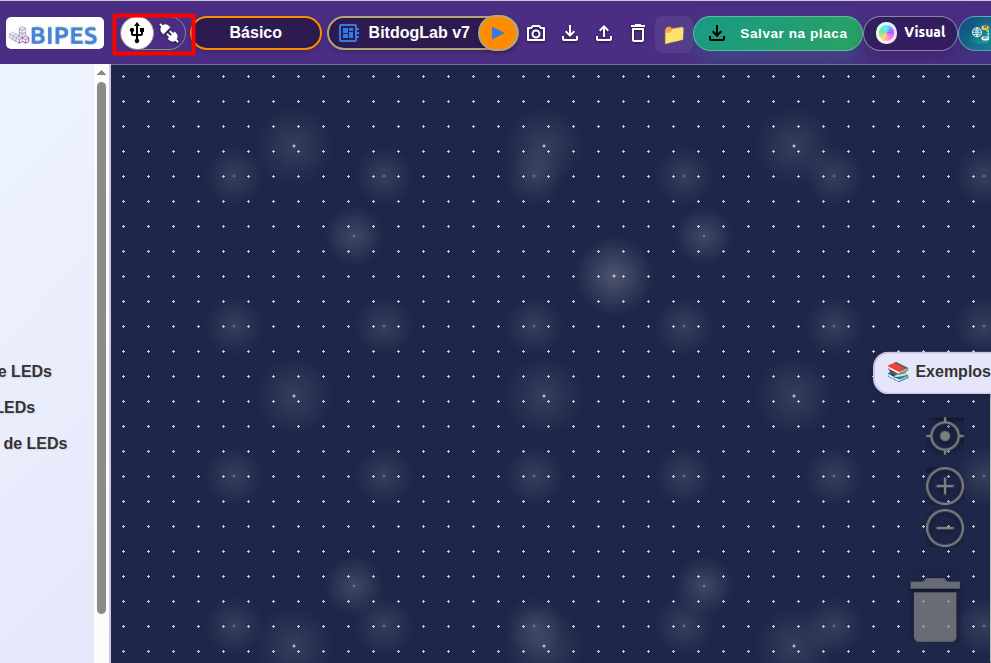
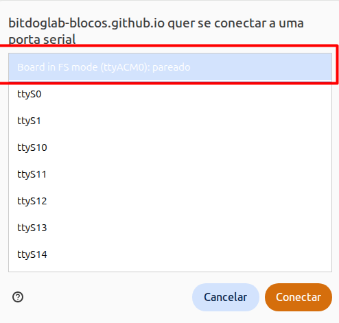
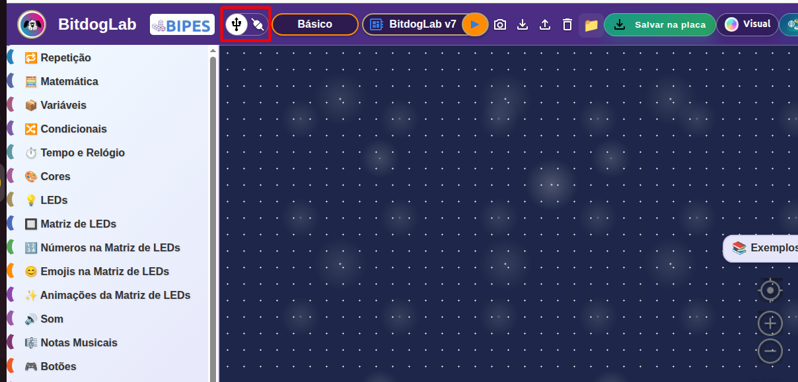

# Acesso à porta serial USB no Linux

## Problema e causa

A plataforma BIPES usa a API Web Serial do navegador para se comunicar com a BitDogLab. No Linux, a API pode não conseguir abrir a porta serial USB se o usuário não tiver permissão de acesso ao dispositivo, por exemplo, por não pertencer ao grupo `dialout` associado à porta.

Este tutorial mostra como verificar e corrigir essa permissão. Nas imagens, a placa aparece como `/dev/ttyACM0` e o grupo responsável pelo acesso é `dialout`.

Em outras distribuições, o dispositivo pode aparecer com outro nome, como `/dev/ttyUSB0`, e pertencer a outro grupo. Confira o grupo da porta no seu sistema antes de executar o comando. O procedimento abaixo serve quando a porta pertence ao grupo `dialout`.

## Passo a passo

### 1. Identifique o erro de conexão

Ao tentar conectar, o BIPES pode informar que não conseguiu abrir a porta USB/serial. Se outra aplicação não estiver usando a placa, verifique também as permissões do dispositivo.



### 2. Abra o Terminal

No Ubuntu, abra a lista de aplicativos e inicie o Terminal.



### 3. Confira os grupos do usuário

No Terminal, execute:

```bash
groups
```

Se `dialout` não aparecer na lista, o usuário atual ainda não pertence a esse grupo.



### 4. Adicione o usuário ao grupo da porta

Se a porta serial pertence ao grupo `dialout`, execute:

```bash
sudo usermod -aG dialout "$USER"
```

Digite a senha do usuário quando solicitado. O `-aG` acrescenta o grupo à lista de grupos suplementares do usuário; o `-a` preserva os demais grupos. [Referência: `usermod(8)` do Debian](https://manpages.debian.org/trixie/passwd/usermod.8.en.html).



> **Atenção:** Fedora, Debian, Ubuntu e outras distribuições podem configurar as portas de maneiras diferentes. Para verificar o grupo da sua placa, conecte-a e consulte o dispositivo que existir no seu sistema, por exemplo:
>
> ```bash
> ls -l /dev/ttyACM0
> ```
>
> ou:
>
> ```bash
> ls -l /dev/ttyUSB0
> ```
>
> Na saída, o grupo aparece junto às permissões do dispositivo. Se for diferente de `dialout`, use o nome exibido no lugar de `dialout` no comando acima. Se nenhum desses dispositivos existir, confira o nome da porta listado pelo sistema.

### 5. Encerre a sessão e entre novamente

As novas permissões de grupo só chegam à sessão depois que ela é iniciada novamente. Salve seu trabalho e reinicie o computador, como nas imagens, ou encerre a sessão e entre nela novamente. [O guia de console serial do Ubuntu também orienta sair e entrar novamente após a alteração.](https://help.ubuntu.com/community/SerialConsoleHowto)





### 6. Confirme que o grupo foi aplicado

Depois de entrar novamente, abra o Terminal e execute:

```bash
groups
```

Confirme que `dialout` aparece na lista. Também é possível consultar os grupos da sessão com `id -nG`.



### 7. Conecte a placa no BIPES

Volte ao BIPES e abra o seletor de conexão USB/serial.



Selecione a porta da BitDogLab — nas imagens, `ttyACM0` — e clique em **Conectar**.



Quando a conexão for estabelecida, o BIPES exibirá o indicador de conexão USB.



## Se ainda não conectar

- Confira se selecionou a porta da placa, como `/dev/ttyACM0` ou `/dev/ttyUSB0`.
- Feche outros programas ou abas que possam estar usando a porta serial, como monitores seriais e IDEs de microcontroladores, e tente novamente.
- Confirme que entrou novamente na sessão depois de alterar os grupos.
- Se a porta pertencer a outro grupo, adicione o usuário a esse grupo em vez de usar `dialout`.

Evite corrigir isso com `chmod 666` na porta: essa mudança ampla pode ser temporária e precisa ser repetida quando o dispositivo é recriado. Use o grupo associado à porta no seu sistema.
